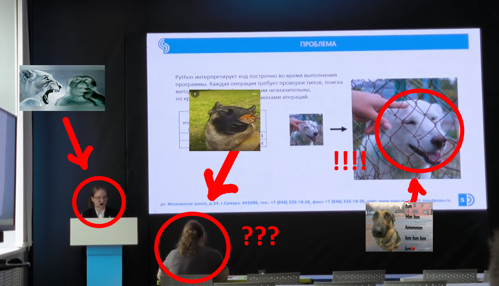
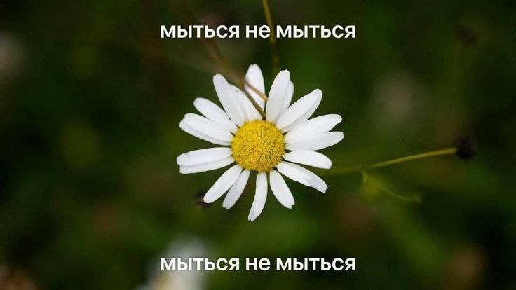

# Лабораторная работа №1 
**ФИО**: Лепаловская Арина Ивановна\
**Группа**: 6403-010302D 

**Научный руководитель**: ГОШИН ЕГОР ВЯЧЕСЛАВОВИЧ\
**Тема диплома**: Исследование метода разреженных представлений в задачах обработки изображений

**Я и мой научник**: 

**Любимая цитата**: 
>А вы о ком подумали, товарищ Берия?

**Любимая картинка**: 

---
**Вступайте в СНО ИИК:** https://t.me/snoiic

---

# Лабораторная работа №2

Разработан web-сайт с подборкой моих любимых мемов.

Сайт состоит из трёх страниц:
- **Главная:** краткое описание сайта и мем дня;
- **Подборка мемов:** галерея с мемами;
- **Оценка мемов:** шуточная система оценки мемов по различным критериям.

Для оформления сайта использована эстетика **Frutiger Aero / Windows XP**.

При разработке использовались HTML и CSS.